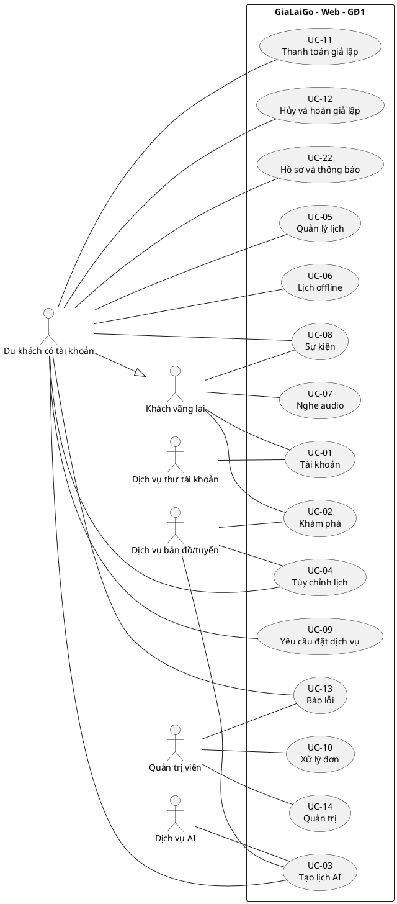
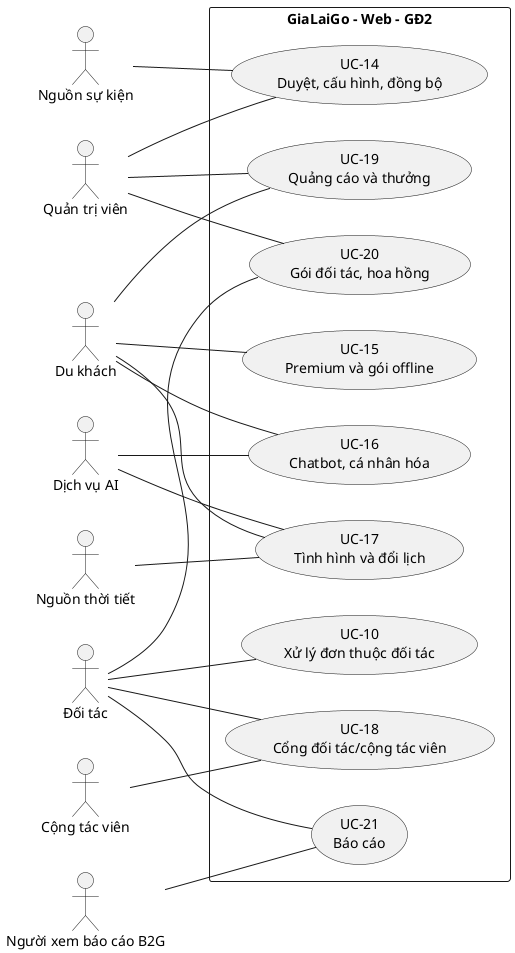

# Use case diagram

## 1. Danh mục use case

| UC | Tên | Tác nhân chính | GĐ | FR |
| --- | --- | --- | --- | --- |
| UC-01 | Đăng ký, đăng nhập và khôi phục tài khoản | Khách vãng lai | 1 | 01 |
| UC-02 | Khám phá địa điểm và dịch vụ | Khách vãng lai | 1 | 03-04,11 |
| UC-03 | Tạo lịch bằng AI | Du khách | 1 | 05 |
| UC-04 | Tùy chỉnh lịch trình | Du khách | 1 | 06 |
| UC-05 | Quản lý lịch đã lưu | Du khách | 1 | 07 |
| UC-06 | Tải và xem lịch offline | Du khách | 1 | 08 |
| UC-07 | Nghe audio | Khách vãng lai | 1/2 | 09,19 |
| UC-08 | Xem, thêm sự kiện vào lịch | Khách / Du khách | 1/2 | 10,25 |
| UC-09 | Gửi yêu cầu đặt dịch vụ | Du khách | 1 | 11 |
| UC-10 | Xử lý đơn và ghi nhận hoàn thành | Quản trị; đối tác ở GĐ2 | 1/2 | 12,14 |
| UC-11 | Thanh toán giả lập đơn dịch vụ | Du khách | 1 | 13 |
| UC-12 | Hủy đơn và hoàn tiền giả lập | Du khách | 1 | 14 |
| UC-13 | Báo lỗi và theo dõi xử lý | Du khách / Quản trị | 1 | 16 |
| UC-14 | Quản trị nội dung và cấu hình | Quản trị | 1/2 | 17-19,25 |
| UC-15 | Mua premium và tải gói nâng cao | Du khách | 2 | 20-21 |
| UC-16 | Chatbot và cá nhân hóa | Du khách | 2 | 22 |
| UC-17 | Xem tình hình và nhận gợi ý đổi lịch | Du khách | 2 | 23-24 |
| UC-18 | Tự phục vụ đối tác/cộng tác viên | Đối tác / Cộng tác viên | 2 | 26 |
| UC-19 | Quảng cáo và chương trình thưởng | Quản trị / Du khách | 2 | 28-29 |
| UC-20 | Gói đối tác và hoa hồng mô phỏng | Đối tác / Quản trị | 2 | 27 |
| UC-21 | Xem và xuất báo cáo | Đối tác / B2G | 2 | 30 |
| UC-22 | Hồ sơ, quyền dữ liệu và thông báo | Du khách | 1/2 | 02,15 |

## 2. UML - Giai đoạn 1

## 3. UML - Giai đoạn 2 bổ sung

## 4. Cách hiểu quan hệ

- Du khách có tài khoản kế thừa quyền đọc công khai của khách vãng lai. Đối tác, cộng tác viên và B2G có vai trò riêng; có tài khoản không đồng nghĩa được quyền du khách hoặc quản trị tự động.
- Các đường liền là tương tác, không biểu thị thứ tự thực hiện.
- Đăng nhập là tiền điều kiện của các chức năng có dữ liệu riêng; không vẽ `include` đăng nhập ở mọi use case vì mỗi lần thao tác không bắt buộc đăng nhập lại.
- Thanh toán là bước riêng chỉ thực hiện khi đơn đã duyệt, không phải phần bắt buộc của việc gửi yêu cầu đặt. Vì vậy không vẽ `include` từ UC-09 sang UC-11.
- Thanh toán giả lập là chức năng bên trong hệ thống; không có tác nhân “cổng thanh toán thật”. Chi tiết thứ tự nằm ở sequence diagram.
