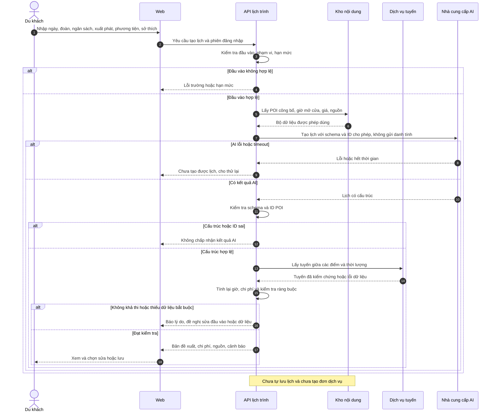
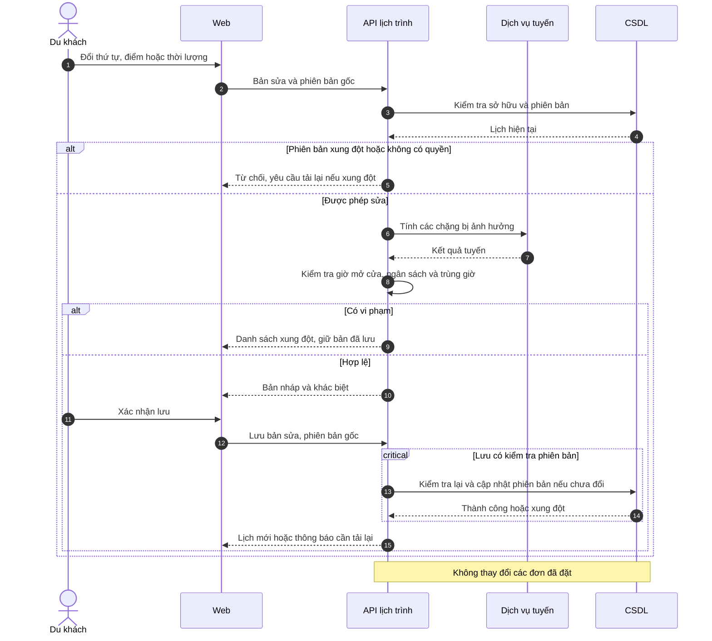
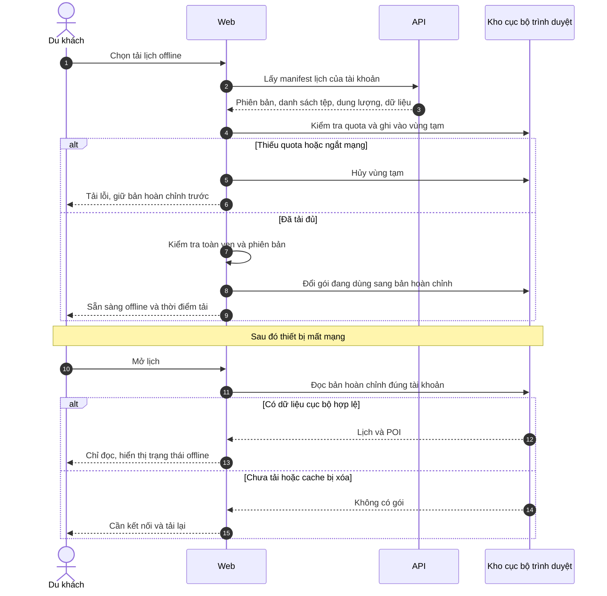
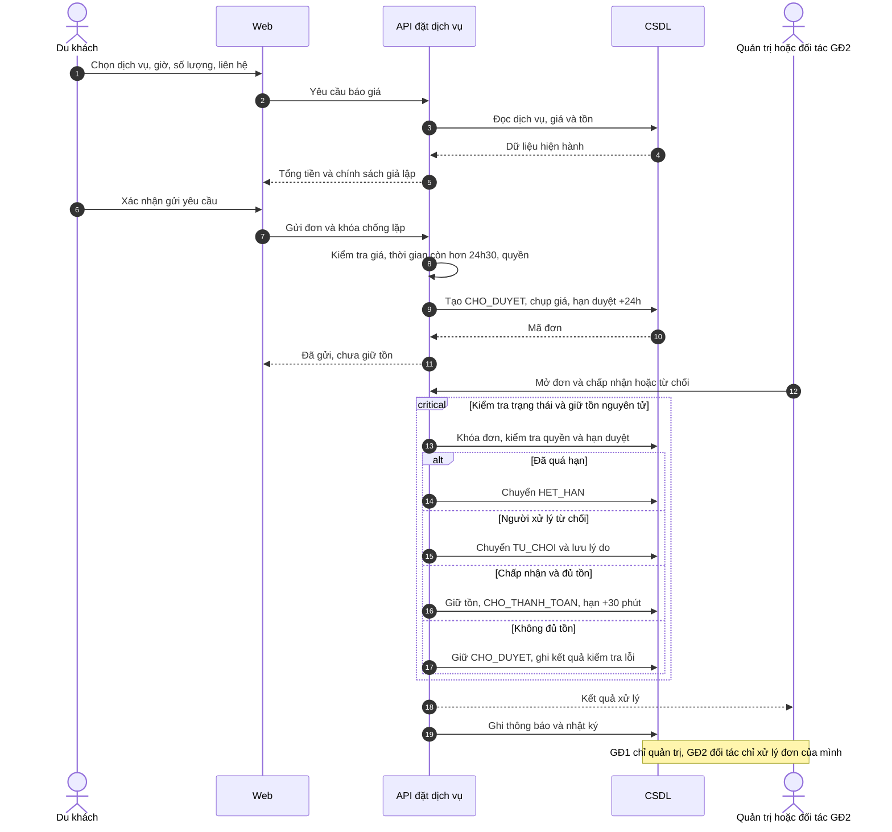
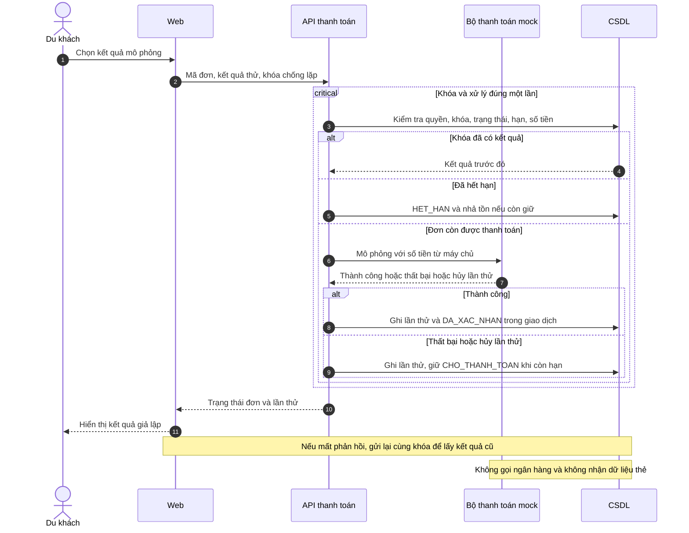
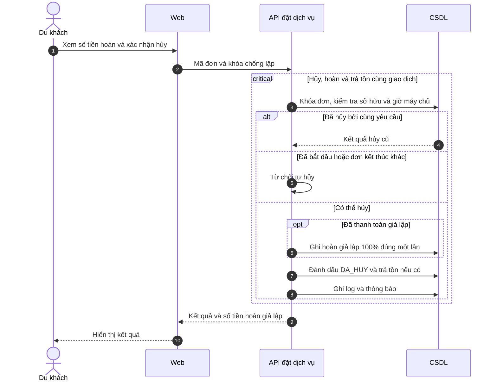
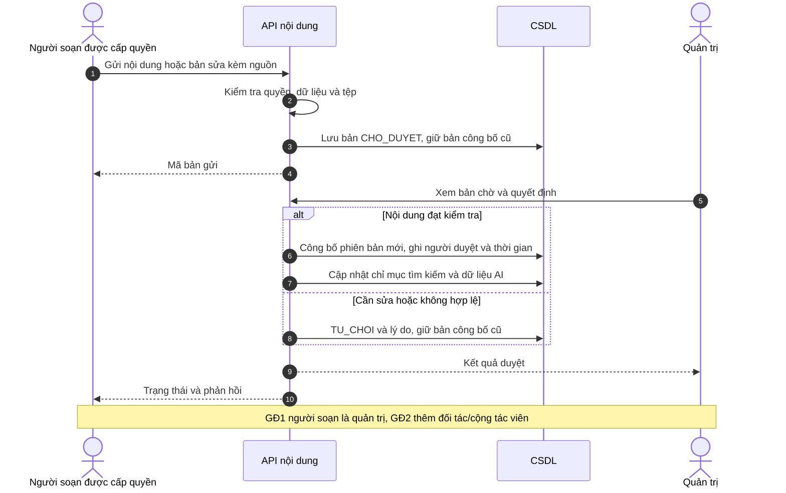
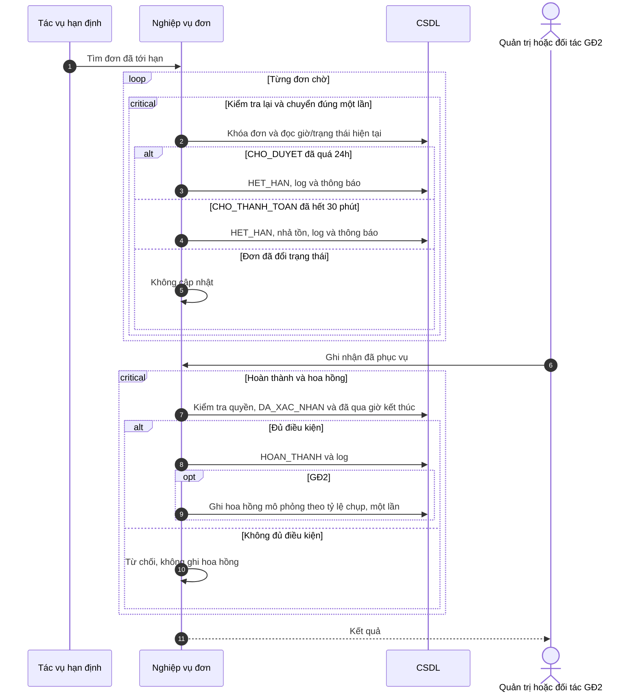
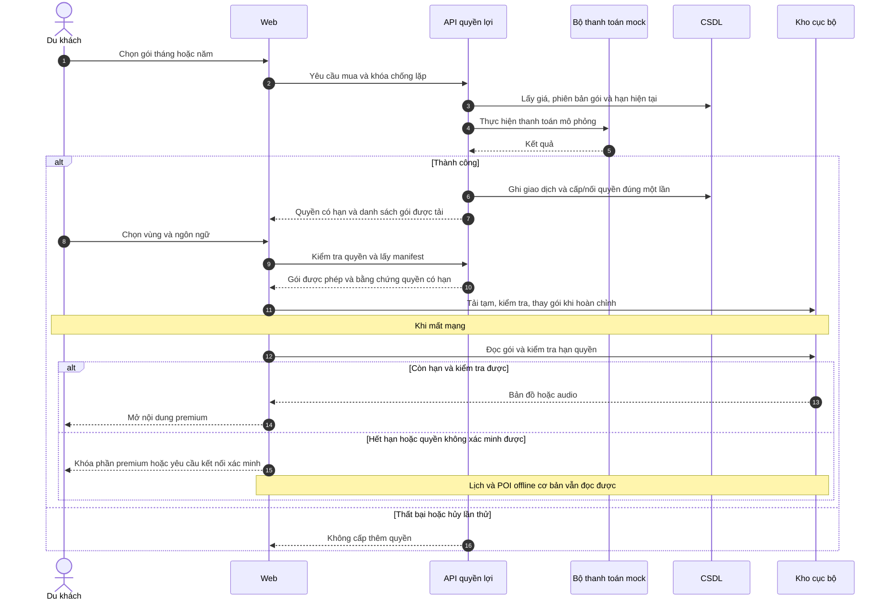
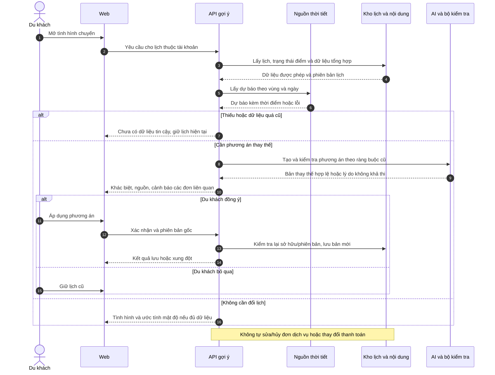

# Sequence diagram

Các participant là **trách nhiệm logic**, không bắt buộc tách thành microservice. CSDL có thể được dùng chung nếu giao dịch và quyền được bảo đảm. Bộ thanh toán mock nằm trong hệ thống; không có cổng thanh toán thật. Các khối `critical` mô tả yêu cầu nguyên tử/khóa, không quy định công nghệ CSDL cụ thể.

## SEQ-01 - Tạo lịch AI thật (UC-03)

## SEQ-02 - Tùy chỉnh và lưu có phiên bản (UC-04/05)

## SEQ-03 - Tải và xem offline cơ bản (UC-06)

Gói cơ bản không chứa dữ liệu liên hệ đặt dịch vụ, mật khẩu hoặc token quản trị. Mở lại offline phụ thuộc app shell và dữ liệu còn trên trình duyệt; đăng xuất xóa dữ liệu riêng của tài khoản khỏi thiết bị.

## SEQ-04 - Đặt và duyệt, giữ tồn (UC-09/10)

Nếu không đủ tồn, người xử lý có thể từ chối đơn với lý do; hệ thống không tự xác nhận, không tự đổi dịch vụ/giá. Mọi nhánh phải kiểm tra trạng thái đang chờ duyệt để thao tác lặp không tạo giữ tồn lần hai.

## SEQ-05 - Thanh toán mock và retry (UC-11)

Không giữ giao dịch CSDL mở trong lúc chờ API thanh toán thật; ở đây mock là thao tác nội bộ nhanh. Nếu thay bằng cổng thật trong tương lai phải thiết kế lại webhook, đối soát và bù trừ ngoài phạm vi SRS này.

## SEQ-06 - Hủy và hoàn giả lập (UC-12)

Lỗi ghi bất kỳ phần nào trong giao dịch phải rollback. Các yêu cầu hủy/thanh toán cạnh tranh kiểm tra lại trạng thái sau khi khóa để không sinh kết quả mâu thuẫn.

## SEQ-07 - Nội dung đóng góp và kiểm duyệt (UC-13/14/18)

Báo lỗi của du khách tạo phiếu riêng, không trực tiếp trở thành bản sửa nội dung. Quản trị xác minh rồi thực hiện luồng trên; thưởng GĐ2 chỉ sau khi phiếu được chấp nhận.

## SEQ-08 - Hết hạn và hoàn thành đơn (UC-10/11)

Tác vụ đề xuất chạy mỗi phút; kể cả chưa chạy, API thanh toán/duyệt vẫn so hạn bằng giờ máy chủ, không cho đơn quá hạn tiếp tục. Tồn được quản lý theo khoảng sử dụng; kết thúc khoảng sử dụng không làm mất lịch sử bán.

## SEQ-09 - Mua premium và dùng offline (UC-15, GĐ2)

Cấp quyền/mua gói cũng phải kiểm tra khóa chống lặp trước khi xử lý; một thanh toán không nối hạn nhiều lần. Lựa chọn lưu offline trên web không tạo cam kết chống sao chép tuyệt đối.

## SEQ-10 - Gợi ý đổi lịch do điều kiện thực tế (UC-17, GĐ2)

## Truy vết và phạm vi biểu diễn

| Sequence | UC chính | Trọng tâm kiểm chứng |
| --- | --- | --- |
| 01 | 03 | AI thật, chỉ dữ liệu duyệt, kiểm tra ràng buộc |
| 02 | 04-05 | Tính lại và chống ghi đè lịch |
| 03 | 06 | Tải nguyên vẹn và chỉ đọc offline |
| 04 | 09-10 | Đơn chờ, hạn duyệt, giữ tồn |
| 05 | 11 | Mock thành công/thất bại/hủy lần thử, retry |
| 06 | 12 | Hủy trước giờ và hoàn đúng một lần |
| 07 | 13-14,18 | Kiểm duyệt và phiên bản nội dung |
| 08 | 10-11,20 | Hết hạn, nhả tồn, hoàn thành và hoa hồng |
| 09 | 15 | Quyền premium, mua mock và tải nâng cao |
| 10 | 17 | Nguồn thời gian thực và quyền quyết định của khách |

Các UC đọc đơn giản, quản lý tài khoản, chương trình thưởng và báo cáo được mô tả bằng luồng ở tệp 04; không cần một sequence riêng cho từng thao tác CRUD. Sequence không quy định tên endpoint, bảng CSDL hay framework.
