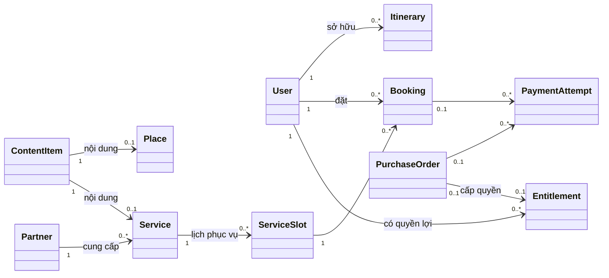
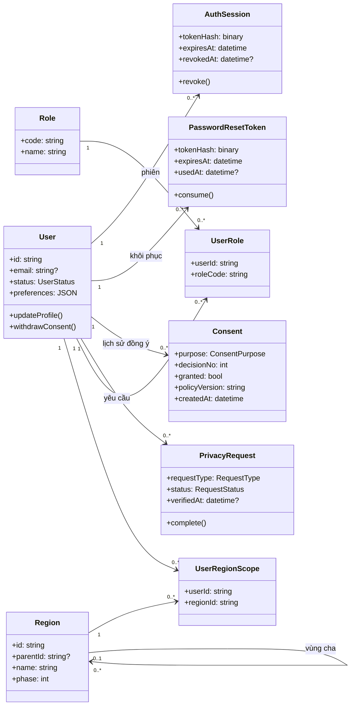
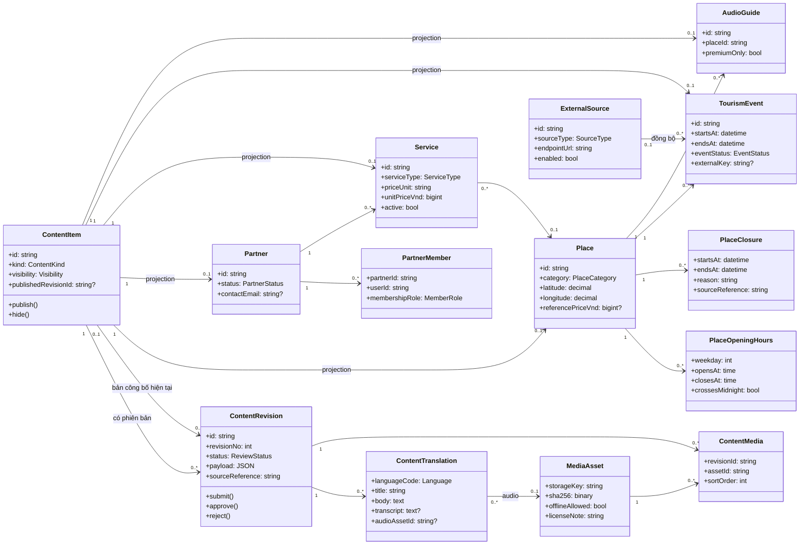
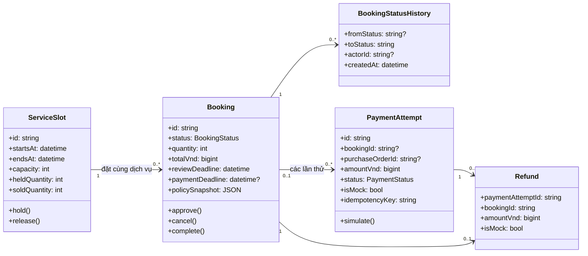
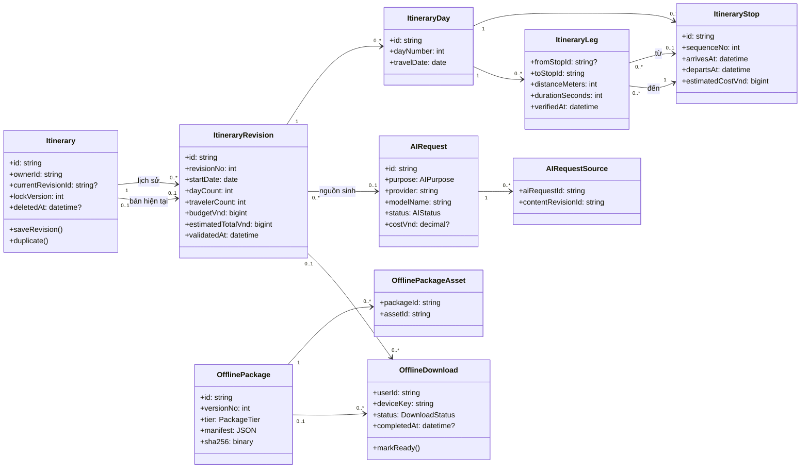
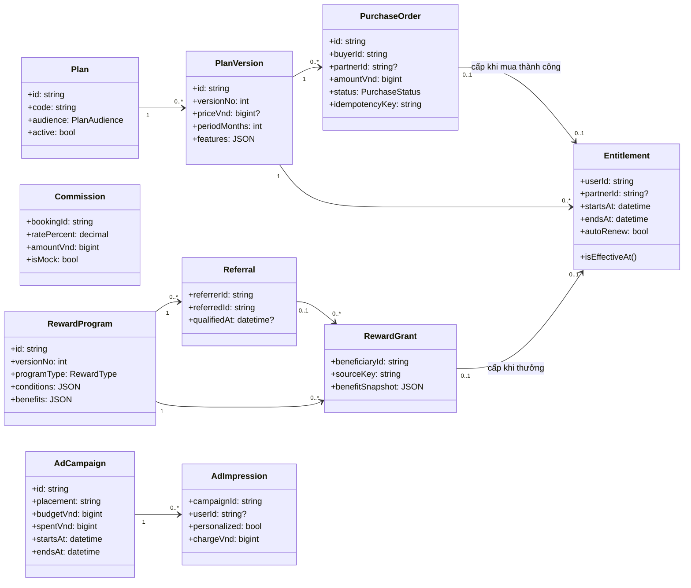
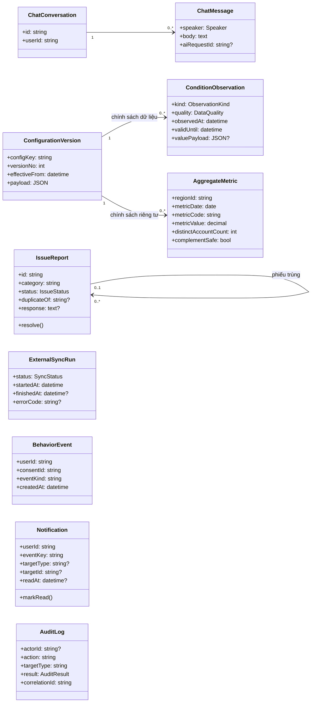

# Class diagram và mô hình dữ liệu

**Phiên bản:** 1.2. **Ngày:** 29/10/2026. **SQL đích:** MariaDB 10.5.26 trên hosting; cú pháp dùng chung MySQL 8.0.16+. 
**Tệp triển khai:** [be/schema.sql](../../be/schema.sql). **Hướng dẫn:** [be/README.md](../../be/README.md).

## 1. Phạm vi và quy ước

Mô hình bao quát GĐ1 và GĐ2 theo SRS. Các lớp thể hiện thực thể miền nghiệp vụ, thuộc tính chính, quan hệ và một số hành vi dự kiến; đây không phải mã backend đã triển khai. Schema có 58 bảng, không thu/chuyển tiền thật và không chứa tài khoản có mật khẩu mặc định.

Schema dùng collation `utf8mb4_unicode_ci` cho bảng; khóa email được chuẩn hóa ở cột sinh `email_key` dùng binary để giữ quy tắc không phân biệt hoa/thường mà vẫn phân biệt dấu. File SQL chạy trong database đang chọn trên phpMyAdmin, không tự tạo/chuyển database.

Mọi thuộc tính ID và tham chiếu ID là **string GUID**, lưu `CHAR(36)` ASCII binary, do backend sinh trước INSERT. Các số tiền và bộ đếm vẫn là kiểu số. Các khóa ghép của bảng liên kết dùng GUID từ thực thể cha; mã danh mục nghiệp vụ không đổi thành GUID.

- Dùng Mermaid `classDiagram`; cần trình xem hỗ trợ Mermaid.
- `1`, `0..1`, `0..*` là bội số. Quan hệ giữa các lớp là liên kết miền nghiệp vụ; khóa ngoại cụ thể nằm trong SQL.
- `?` biểu thị thuộc tính có thể NULL; dấu `+` biểu thị thuộc tính/hành vi công khai trong mô hình, không phải quyền đọc API.
- Một người dùng có nhiều vai trò. Premium là quyền lợi có hạn của người dùng, không phải lớp con hay vai trò quản trị.
- Các phương thức như `approve()`, `cancel()` là trách nhiệm của tầng nghiệp vụ; file SQL chỉ tạo cấu trúc, không tự triển khai các phương thức này.
- Mỗi lớp dữ liệu có bảng ánh xạ ở mục 4. Các lớp chỉ liệt kê thuộc tính chính; SQL là bản đầy đủ về cột, kiểu, index và ràng buộc.
- GĐ2 có thể được tạo sẵn bảng khi khởi tạo CSDL nhưng chưa mở tính năng trong GĐ1.

## 2. Sơ đồ tổng quan

Hai đích của `PaymentAttempt` là loại trừ nhau: mỗi lần thử thanh toán thuộc một đơn dịch vụ **hoặc** một đơn mua gói. Sửa/xóa lịch trình không tự sửa/xóa đơn dịch vụ; không thiết lập quan hệ phụ thuộc vòng đời giữa hai thực thể này.

## 3. Sơ đồ chi tiết theo nhóm

### 3.1. Tài khoản và phạm vi truy cập

### 3.2. Nội dung địa phương và cộng đồng

### 3.3. Đặt dịch vụ và thanh toán giả lập

### 3.4. Lịch trình, AI và offline

### 3.5. Gói dịch vụ, quảng cáo và thưởng

### 3.6. Vận hành, dữ liệu và báo cáo

## 4. Ánh xạ lớp sang bảng và yêu cầu

| Nhóm | Lớp miền nghiệp vụ | Bảng SQL | Truy vết SRS |
| --- | --- | --- | --- |
| 1 | `User` | `users` | FR-01,02,18; NFR-07 đến NFR-14 |
| 1 | `Role` | `roles` | FR-01,02,18; NFR-07 đến NFR-14 |
| 1 | `UserRole` | `user_roles` | FR-01,02,18; NFR-07 đến NFR-14 |
| 1 | `Region` | `regions` | FR-01,02,18; NFR-07 đến NFR-14 |
| 1 | `UserRegionScope` | `user_region_scopes` | FR-01,02,18; NFR-07 đến NFR-14 |
| 1 | `AuthSession` | `auth_sessions` | FR-01,02,18; NFR-07 đến NFR-14 |
| 1 | `PasswordResetToken` | `password_reset_tokens` | FR-01,02,18; NFR-07 đến NFR-14 |
| 1 | `Consent` | `consents` | FR-01,02,18; NFR-07 đến NFR-14 |
| 1 | `PrivacyRequest` | `privacy_requests` | FR-01,02,18; NFR-07 đến NFR-14 |
| 2 | `ContentItem` | `content_items` | FR-03,04,09,10,17,19,25,26 |
| 2 | `ContentRevision` | `content_revisions` | FR-03,04,09,10,17,19,25,26 |
| 2 | `MediaAsset` | `media_assets` | FR-03,04,09,10,17,19,25,26 |
| 2 | `ContentTranslation` | `content_translations` | FR-03,04,09,10,17,19,25,26 |
| 2 | `ContentMedia` | `content_media` | FR-03,04,09,10,17,19,25,26 |
| 2 | `Place` | `places` | FR-03,04,09,10,17,19,25,26 |
| 2 | `PlaceOpeningHours` | `place_opening_hours` | FR-03,04,09,10,17,19,25,26 |
| 2 | `PlaceClosure` | `place_closures` | FR-03,04,09,10,17,19,25,26 |
| 2 | `Partner` | `partners` | FR-03,04,09,10,17,19,25,26 |
| 2 | `PartnerMember` | `partner_members` | FR-03,04,09,10,17,19,25,26 |
| 2 | `Service` | `services` | FR-03,04,09,10,17,19,25,26 |
| 3 | `ServiceSlot` | `service_slots` | FR-11 đến FR-14; NFR-05,19 |
| 2 | `ExternalSource` | `external_sources` | FR-03,04,09,10,17,19,25,26 |
| 2 | `TourismEvent` | `events` | FR-03,04,09,10,17,19,25,26 |
| 2 | `AudioGuide` | `audio_guides` | FR-03,04,09,10,17,19,25,26 |
| 6 | `ConfigurationVersion` | `config_versions` | FR-15,16,18,22 đến FR-25,30; NFR-11 đến NFR-14,22 |
| 4 | `Itinerary` | `itineraries` | FR-05 đến FR-08,20,21; NFR-02,03,17,20 |
| 4 | `AIRequest` | `ai_requests` | FR-05 đến FR-08,20,21; NFR-02,03,17,20 |
| 4 | `AIRequestSource` | `ai_request_sources` | FR-05 đến FR-08,20,21; NFR-02,03,17,20 |
| 4 | `ItineraryRevision` | `itinerary_revisions` | FR-05 đến FR-08,20,21; NFR-02,03,17,20 |
| 4 | `ItineraryDay` | `itinerary_days` | FR-05 đến FR-08,20,21; NFR-02,03,17,20 |
| 4 | `ItineraryStop` | `itinerary_stops` | FR-05 đến FR-08,20,21; NFR-02,03,17,20 |
| 4 | `ItineraryLeg` | `itinerary_legs` | FR-05 đến FR-08,20,21; NFR-02,03,17,20 |
| 3 | `Booking` | `bookings` | FR-11 đến FR-14; NFR-05,19 |
| 3 | `BookingStatusHistory` | `booking_status_history` | FR-11 đến FR-14; NFR-05,19 |
| 5 | `Plan` | `plans` | FR-20,27 đến FR-29 |
| 5 | `PlanVersion` | `plan_versions` | FR-20,27 đến FR-29 |
| 5 | `PurchaseOrder` | `purchase_orders` | FR-20,27 đến FR-29 |
| 3 | `PaymentAttempt` | `payment_attempts` | FR-11 đến FR-14; NFR-05,19 |
| 3 | `Refund` | `refunds` | FR-11 đến FR-14; NFR-05,19 |
| 5 | `Commission` | `commissions` | FR-20,27 đến FR-29 |
| 6 | `IssueReport` | `issue_reports` | FR-15,16,18,22 đến FR-25,30; NFR-11 đến NFR-14,22 |
| 5 | `RewardProgram` | `reward_programs` | FR-20,27 đến FR-29 |
| 5 | `Referral` | `referrals` | FR-20,27 đến FR-29 |
| 5 | `RewardGrant` | `reward_grants` | FR-20,27 đến FR-29 |
| 5 | `Entitlement` | `entitlements` | FR-20,27 đến FR-29 |
| 4 | `OfflinePackage` | `offline_packages` | FR-05 đến FR-08,20,21; NFR-02,03,17,20 |
| 4 | `OfflinePackageAsset` | `offline_package_assets` | FR-05 đến FR-08,20,21; NFR-02,03,17,20 |
| 4 | `OfflineDownload` | `offline_downloads` | FR-05 đến FR-08,20,21; NFR-02,03,17,20 |
| 6 | `ChatConversation` | `chat_conversations` | FR-15,16,18,22 đến FR-25,30; NFR-11 đến NFR-14,22 |
| 6 | `ChatMessage` | `chat_messages` | FR-15,16,18,22 đến FR-25,30; NFR-11 đến NFR-14,22 |
| 6 | `ConditionObservation` | `condition_observations` | FR-15,16,18,22 đến FR-25,30; NFR-11 đến NFR-14,22 |
| 6 | `ExternalSyncRun` | `external_sync_runs` | FR-15,16,18,22 đến FR-25,30; NFR-11 đến NFR-14,22 |
| 5 | `AdCampaign` | `ad_campaigns` | FR-20,27 đến FR-29 |
| 5 | `AdImpression` | `ad_impressions` | FR-20,27 đến FR-29 |
| 6 | `BehaviorEvent` | `behavior_events` | FR-15,16,18,22 đến FR-25,30; NFR-11 đến NFR-14,22 |
| 6 | `AggregateMetric` | `aggregate_metrics` | FR-15,16,18,22 đến FR-25,30; NFR-11 đến NFR-14,22 |
| 6 | `Notification` | `notifications` | FR-15,16,18,22 đến FR-25,30; NFR-11 đến NFR-14,22 |
| 6 | `AuditLog` | `audit_logs` | FR-15,16,18,22 đến FR-25,30; NFR-11 đến NFR-14,22 |

Các quan hệ xuyên nhóm được thực thi qua khóa ngoại: người dùng–đơn/lịch; vùng–địa điểm/gói offline; địa điểm–điểm dừng; nội dung–nguồn AI; đơn–hoa hồng; quyền lợi–tải offline; phiếu báo lỗi–thưởng; consent–hành vi. `notifications.target_type/target_id` và đích của audit log là tham chiếu đa hình: không có FK chung cho mọi loại, nên API phải kiểm tra tồn tại và quyền trước khi trả dữ liệu.

## 5. Quyết định thiết kế quan trọng

### 5.1. Phiên bản nội dung và lịch trình

- `content_items` là định danh ổn định. `content_revisions` và `content_translations` giữ bản nháp/bản duyệt theo ngôn ngữ. Con trỏ `published_revision_id` chỉ được trỏ tới revision của chính nội dung đó bằng khóa ngoại ghép.
- `places`, `services`, `events`, `partners`, `audio_guides` là projection có cấu trúc của bản công bố. Khi duyệt phải kiểm tra đúng `kind`, cập nhật projection và con trỏ công bố trong cùng giao dịch. Bản sửa chưa duyệt chỉ lưu trong revision, không ghi đè projection.
- Bài viết và cụm từ Jrai dùng trực tiếp `content_items` + revision + translation; không cần bảng con rỗng.
- Revision đã công bố hoặc đã dùng làm lịch sử cần được giữ bất biến bằng quy tắc API/quyền CSDL. Lịch cũ có snapshot dữ liệu và tham chiếu revision nguồn.
- `itineraries` là chủ thể chuyến đi; mỗi lần lưu tạo `itinerary_revisions` cùng ngày, điểm dừng và chặng tương ứng. Cập nhật bản hiện tại có kiểm tra `lock_version`; sửa từ tab cũ bị từ chối.
- Xóa lịch dùng `deleted_at` để phát tombstone cho đồng bộ thiết bị. Tác vụ xóa dữ liệu riêng theo chính sách có thể dọn revision sau khi xử lý các tham chiếu AI/offline; không ảnh hưởng đơn đặt độc lập.

### 5.2. Đặt dịch vụ và tồn khả dụng

- Mỗi đơn đặt một `service_slot`. Slot xác định dịch vụ, khoảng bắt đầu/kết thúc và sức chứa. Dịch vụ lưu trú nhiều đêm hoặc nhiều khung giờ cần backend tạo một slot cho toàn khoảng yêu cầu, hoặc bổ sung mô hình phân bổ tồn chi tiết trước khi hỗ trợ; không được tạo các slot chồng lấn cùng tài nguyên rồi coi chúng là tồn độc lập.
- Chốt thiết kế ban đầu: backend chỉ công bố các slot độc lập, không chồng lấn trên cùng quỹ tài nguyên. Người dùng chọn đúng slot; không tự nhập khoảng bất kỳ ngoài lịch phục vụ. Đây là cách triển khai lịch khả dụng, không thay quy tắc thời hạn/hủy đã xác nhận.
- `service_slots` có `held_quantity` và `sold_quantity`; CHECK chặn tổng vượt `capacity`. Chờ duyệt chưa giữ tồn. Duyệt tăng held; trả tiền chuyển held sang sold; hết hạn chờ trả tiền giảm held; hủy giảm đúng phần đang giữ/đã bán.
- `bookings` chụp giá, quy tắc, mô tả dịch vụ và giờ sử dụng. Khi tạo phải đối chiếu slot; không đổi giờ hoặc loại dịch vụ của slot đã có đơn.
- Một đơn thuộc đúng dịch vụ của slot nhờ khóa ngoại ghép. Tổng tiền = số lượng × giá đơn vị; tỷ lệ hoa hồng 0–100%.
- CHECK trong từng dòng không thể chứng minh tổng tồn bằng tổng mọi đơn hoặc kiểm soát toàn bộ state machine. Backend phải dùng giao dịch và khóa theo hướng dẫn trong `be/README.md`.

### 5.3. Thanh toán, quyền lợi và cấu hình

- `payment_attempts` có nhiều lần thất bại/hủy nhưng tối đa một lần thành công trên mỗi đơn nhờ cột sinh và UNIQUE. `idempotency_key` của lần thử là duy nhất; máy chủ phải ràng buộc khóa với đúng chủ thể, đích và payload.
- CHECK bắt buộc `is_mock = 1`; không có bảng dữ liệu thẻ hoặc token ngân hàng.
- `refunds` chỉ cho một bản hoàn trên một payment và FK ghép buộc đúng booking. Việc payment đã thành công và số hoàn bằng toàn bộ số đã trả được kiểm tra trong giao dịch hủy.
- `purchase_orders` dành cho mua gói; `bookings` dành cho dịch vụ thực tế. Không trộn hai state machine.
- `entitlements` được cấp từ đúng một đơn mua thành công hoặc một sự kiện thưởng hợp lệ. CSDL lưu khoảng hiệu lực; API kiểm tra gói đúng đối tượng, chủ tài khoản, đối tác và nguồn cấp. Mua thêm nối hạn theo BR-14; `auto_renew = 0`.
- Chỉ seed giá premium đã xác nhận và cấu hình nghiệp vụ mặc định; gói đối tác chưa cấu hình giá/quyền lợi để trạng thái chưa kích hoạt. Không seed dữ liệu điểm đến, API giả hoặc ngưỡng dự báo mật độ chưa kiểm chứng.

### 5.4. Offline, AI và báo cáo

- CSDL lưu manifest và metadata tải. App shell, nội dung lịch/audio/bản đồ offline thật nằm ở Cache API/IndexedDB trên trình duyệt, không nằm trong MySQL. Gói cơ bản có đích là revision lịch; gói nâng cao có đích là package.
- Tải premium phải có quyền hợp lệ, asset được phép lưu offline và bằng chứng quyền có hạn. CSDL không thể xác minh thời gian/khả năng lưu của thiết bị đang mất mạng.
- AI lưu provider/model, phiên bản prompt, trạng thái, chi phí và revision nguồn. Không gửi/lưu email, mật khẩu hoặc liên hệ đặt dịch vụ trong context AI; kiểm tra output là trách nhiệm backend.
- Đồng ý là lịch sử theo purpose; backend cấp `decision_no` tăng theo tài khoản/mục đích trong giao dịch có khóa, lấy bản mới nhất theo số này và kiểm tra đúng chủ, mục đích trước ghi/đọc hành vi. GUID không được dùng để suy ra thứ tự. Chỉ có FK tới consent chưa đủ chứng minh người dùng đang đồng ý.
- `aggregate_metrics` là dữ liệu nội bộ. View `b2g_released_metrics` chỉ đưa nhóm ≥10 tài khoản và đã qua đánh giá suy ngược `complement_safe`. API còn phải áp scope vùng và kiểm tra bộ lọc; không cấp B2G quyền SELECT bảng gốc.
- Đặt `complement_safe = TRUE` chỉ sau pipeline kiểm tra tổng/chênh lệch giữa nhóm, không tự bật chỉ vì đủ 10 người.

## 6. Ranh giới bảo đảm

| CSDL kiểm tra trực tiếp | Backend hoặc vận hành phải bảo đảm |
| --- | --- |
| Khóa chính, khóa ngoại, đích payment/download loại trừ nhau | Quyền theo tài khoản, đối tác, vùng; email/schema đầu vào và giới hạn tần suất |
| Tổng tiền, số lượng dương, khoảng thời gian hợp lệ, trần tồn | Giờ mở cửa, chống trùng lịch, giờ di chuyển thực tế và ngân sách AI |
| Tối đa một payment thành công/đơn, một refund/payment | State machine, hạn theo giờ máy chủ, giá từ máy chủ và hoàn đủ 100% |
| Bản hiện tại thuộc đúng content/lịch | Revision được công bố phải đúng trạng thái/kind và không bị sửa trực tiếp |
| Nguồn thưởng, UNIQUE chống cấp lặp | Xác minh báo lỗi trùng, điều kiện thưởng và quyền lợi đúng người |
| Quảng cáo không vượt ngân sách lưu trong dòng | Khóa khi tính phí lượt hiển thị; không hiển thị cho premium; cá nhân hóa theo đồng ý |
| View báo cáo đã lọc ngưỡng và cờ an toàn | Phân quyền view, chống suy ngược và giới hạn bộ lọc |
| Dữ liệu có cột hết hạn/thu hồi | Tác vụ hết hạn, xóa cache, dọn log, sao lưu và thu hồi phiên |

Thiết kế không tuyên bố chỉ chạy schema là đã đáp ứng tất cả yêu cầu SRS. Các phép kiểm tra liên bảng, giao dịch và quyền phải được triển khai rồi kiểm thử khi xây dựng backend.
